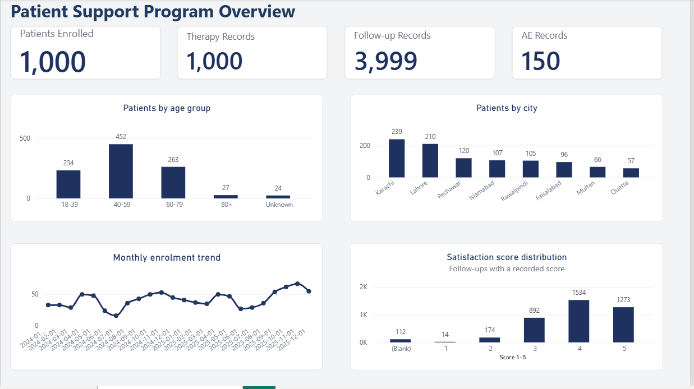

# Healthcare Patient Support Program (PSP) Analytics & Dashboard (MySQL & Power BI)

## Project Overview
An end-to-end healthcare operations and pharmacovigilance data analytics project built using **MySQL** and **Power BI**. Using a structured synthetic Patient Support Program (PSP) dataset (1,000 patients across 8 major cities in Pakistan), this project performs comprehensive data integrity audits, analyzes patient adherence, follow-up outreach, therapy retention, and adverse event (AE) reporting, and delivers an interactive Power BI dashboard connected directly to MySQL views.

*(Note: This project uses a synthetic dataset created for portfolio and training purposes and contains no real patient records.)*

## Tools & Technical Workflow
* **Microsoft Excel:** Initial data cleaning, standardizing date/numeric fields, and clearing out-of-range adherence entries while preserving raw audit columns.
* **MySQL (`psp_analysis_sql_final.sql`):**
  * **Data Integrity & Audit Trail:** Verified row counts, checked for orphan records across relational joins, validated numeric ranges (0–100% adherence, 1–5 satisfaction), and flagged logical anomalies (e.g., adherence values recorded on `Not Reached` calls).
  * **Exploratory & Operational Queries:** Analyzed patient demographics, city-level outreach performance, therapy status, and pharmacovigilance reporting rates.
  * **Database Views:** Created 12 reusable SQL views (`vw_kpi_core_counts`, `vw_outcomes_by_city`, `vw_ae_pv_reporting`, etc.) to serve clean aggregated data directly to Power BI.
* **Power BI (`psp_dashboard_powerBI.pbix`):** Connected directly to the `psp_sql_project` MySQL database to build an interactive executive overview featuring KPI cards, demographic breakdowns, enrolment trends, and satisfaction distributions.

## Dashboard Preview

## Key Findings
* **Program Scale & Core Metrics:** Tracked **1,000 enrolled patients**, **1,000 therapy records**, **3,999 follow-up call records**, and **150 adverse event (AE) records** across 40 prescribing doctors.
* **Geographic & Age Distribution:** Patient enrolment was highest in **Karachi (239)** and **Lahore (210)**, followed by **Peshawar (120)** and **Islamabad (107)**. The **40–59 age group** represented the largest patient segment (**452 patients**), followed by **60–79 (263)** and **18–39 (234)**.
* **Adherence & Patient Satisfaction:** Across valid follow-ups, average medication adherence was **81.37%** (with **1.52 average missed doses**), and patient satisfaction averaged **4.00 out of 5** (**2,807 follow-ups** scored 4 or 5).
* **Therapy Retention & Pharmacovigilance:** **58.8% (588)** of patients remained on active therapy, **19.9% (199)** completed treatment, and **21.3% (213)** discontinued. Out of **150 adverse events**, **88.0% (132)** were flagged as reported to Pharmacovigilance (`reported_to_PV = 'Y'`).
* **Data Quality Audit Discovery:** Flagged **760 `Not Reached` follow-up calls** that still carried recorded adherence percentages—identifying an important operational data-entry gap requiring business rule alignment before clinical reporting.

## Files Included
* `psp_analysis_sql_final.sql` – Complete MySQL script covering schema checks, data integrity audits, operational KPIs, and Power BI summary views.
* `psp_dashboard_powerBI.pbix` – Power BI Desktop file connected to the MySQL `psp_sql_project` database.
* `PSP_Dashboard_png.png` – High-resolution preview of the Patient Support Program Overview dashboard.

